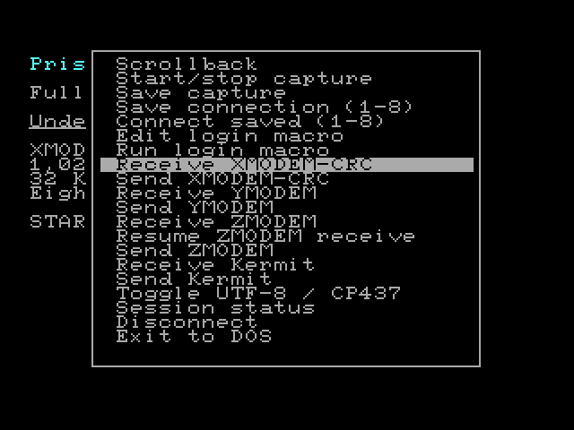

# PrismTerm 0.3

**Your Atari. The whole world.**

Experimental release.

An independently maintained fork of **VBXETERM v0.25** for a 64 KiB Atari XL/XE with a 512 KiB VBXE FX expansion, using R: serial or FujiNet N:.

Version 0.3 adds a **Procomm-inspired local menu system**, editable connection profiles, unified transfer forms, and selectable serial baud rates. It retains **ZMODEM, Kermit, and Unicode glyph rendering** from 0.2. Native mode handles UTF-8 scalars, wide glyphs and bitmap combining marks. The included **host companion supplies complex shaping, bidirectional layout and emoji sequences** using Pango/HarfBuzz/FriBidi. Full text layout therefore requires the companion; it is not an all-native Unicode shaping engine.

PrismTerm is maintained by **Robert Dupuy**. It builds on **Brad Colbert's VBXETERM/ca65 work** and **Joseph Zatarski's original terminal**. Extensions and tests were implemented with OpenAI Codex. The original [license](license.txt), author notices and upstream history are retained; see [CREDITS.md](CREDITS.md). Development continues independently in this repository. This is not an official upstream release.

Upstream: https://github.com/brad-colbert/ansivbxe  
Pinned commit: `c7d8bbc2c95718bb9fc0847fb8fe43ba42b9f60f`



## Boot and connect

1. Mount `release/PRISMTERM-D600.ATR` as D1:, or the **D700** variant if that matches your VBXE register address. Enable writes for captures or saved connections.
2. Mount `fonts/UNICODE.ATR` as **D2:**, read-only. This 6.2 MB indexed font disk contains 126,947 glyphs; it is a raw sector image, not a DOS filesystem. It requires a disk-image device that supports 256-byte sectors and 16-bit sector numbers.
3. Boot with **BASIC disabled**. The disk loads the original R: handler as `RS232.AR0`, then `PRISM.AR1`. Keep matching `TRANS.BIN` and `UI.BIN` on D1:; startup loads the protocol/Unicode and menu banks from them.
4. Use **Connect → Quick connect / new profile** for FujiNet Telnet, raw TCP or SSH. Enter the host and optional port, then press **C** to connect. Default ports are 23 for Telnet/raw TCP and 22 for SSH. For R:, choose **Connect → Serial port / baud rate**, select the speed, and press **C**.
5. Select **Display → Encoding** for UTF-8 hosts. `ESC % G` also enables UTF-8. For complex scripts, follow [the companion setup](bridge/README.md).

For manual installation, use `release/D600/` or `release/D700/`: copy its **matching** `PRISM.XEX`, `TRANS.BIN` and `UI.BIN`, plus the contents of `disk/`, onto a DOS disk. Load the R: handler before the XEX for serial use. Native fonts and palettes use `D:` paths. FujiNet supplies SSH encryption and authentication.

A missing/unreadable `UI.BIN` falls back to the earlier menus and R/N startup prompt. Keep all three binaries from the same build together. A missing/unreadable `TRANS.BIN` disables ZMODEM, Kermit and custom Unicode glyphs; the terminal and original transfers remain available. A missing D2: font disk produces replacement boxes for unavailable glyphs. Mount it before starting; restarting clears a cached font-disk failure. The companion sends glyph pixels directly and does not need D2:.

## File transfers

Start the corresponding transfer on the remote, then select **Transfer → Send a file** or **Receive a file**. Choose the protocol, enter a local Atari filename such as `D:FILE.BIN`, and select **Begin transfer**. Normal receives ask before replacing an existing file. The progress panel reports actual wire RX/TX bytes, including protocol overhead; these are not file percentages. Remote filenames never choose a local path. **Escape** cancels; a partial receive is retained. Exit the Unicode companion before transferring and restart it afterward.

| Protocol | Implemented behavior |
|---|---|
| ZMODEM | Send and receive one file; CRC16 and CRC32 reception; hex/binary headers; control-byte quoting; 1 KiB bounded subpackets; CRC validation before committing data; ZRPOS recovery; exact EOF length; retries and cancellation. Outgoing data uses CRC16 and acknowledged frames. Additional incoming batch members are explicitly skipped. |
| ZMODEM resume | **Resume = Yes** in the ZMODEM receive form reads the existing local prefix, asks the sender for its CRC32, and appends only if it matches. Missing/empty files start at zero. Mismatch or unsupported prefix verification leaves the existing file untouched. Sender-side ZRPOS requests are also supported through reopen-and-discard seeking. |
| Kermit | Basic short-packet, stop-and-wait binary transfers; type-1 block checksum; control and negotiated eighth-bit quoting; sequence wrap; duplicate suppression; retries; file/end-of-batch transactions and exact length. No long packets, sliding windows, negotiated repeat compression, or type-2/type-3 checksums. |
| XMODEM-CRC | Receive 128-byte/1 KiB packets; send 1 KiB packets. The last packet's padding remains because XMODEM has no length field. |
| YMODEM | Single-file, exact length, metadata/end-of-batch handshake. Sending scans the file once to determine its size. |

For a Linux host with lrzsz, use `sz -b filename` to send to the Atari, or `rz -b` to receive from it. With C-Kermit, use binary mode (`set file type binary`) and `send filename` or `receive`. Transfers are started manually; there is no automatic download prompt. ZCOMMAND execution, file timestamps, remote filesystem operations, checksum-only XMODEM and YMODEM-G are not implemented.

Telnet requires negotiated binary mode in both directions. Transfers refuse a non-binary Telnet connection; raw TCP and R: are alternatives. Menus send XOFF on entry and XON on exit. R: concurrent I/O is suspended around disk operations and restored afterward. Streaming ZMODEM reception and font cache misses depend on transport buffering/flow control during disk access. Actual serial-handler and FujiNet timing still need hardware validation.

## Unicode display

| Mode | Display and behavior |
|---|---|
| Native | 80×24, or 40×24 in wide display mode; 8-pixel-high glyphs. Streaming UTF-8 through U+10FFFF, invalid-sequence handling, supplementary-plane lookup, one/two-cell widths, and zero-width bitmap marks. CP437-compatible text retains its fast path. |
| Companion | 80×12 logical characters across 640×192 pixels; 16-pixel-high layout. The host performs grapheme handling, contextual shaping, bidi ordering, font fallback and emoji composition, then sends CRC-checked 8×8 pixel cells. Only changed cells are transmitted. |

Native glyphs come from GNU Unifont 17.0.04, with Unicode 17 width data. Missing characters become a visible replacement box. Eight-pixel cells are dense; combining marks are bitmap overlays, without native typographic positioning, Arabic joining, Indic shaping or emoji ligatures. The companion provides those capabilities, subject to installed fonts and the display's resolution. Its output uses the 16-color palette and at most two colors per 8×8 tile; emoji detail and color are reduced. It does not promise glyphs for every assigned/private-use character or complete xterm compatibility.

Pixels belong to screen cells, so cache eviction cannot change an existing character. Scrolling, insertion/deletion, dialogs, alternate screens and scrollback preserve custom pixels. Activating custom Unicode rendering clears the old history ring and changes its capacity from **1,024 native lines to 256 pixel-bearing lines**. Full reset (`ESC c`) returns to the native renderer and clears history.

## Other features and controls

- **START:** opens Connect, Transfer, Session, Display and Help. **OPTION** opens Display directly.
- **Left / Right**, **`<` / `>`**, or **Tab** changes category. **C/T/S/D/H** jumps directly to a category. **`-` / `=`** or cursor Up / Down selects an item; **Return** opens it and **Escape** backs out.
- Navy panels, cyan selection and a **LOCAL MENU** badge distinguish the terminal controls from the remote BBS. The full 24-line BBS screen, styles, Unicode pixels and parser state return when menus close. The same forms fit 40 and 80 columns.
- **Connect → Connection directory:** eight named slots, **1–8** selects, **E** edits, **N** creates, **Return** connects. Form fields commit on Return; Escape cancels an unfinished field or form. **S** saves, with confirmation before replacing a slot.
- **Serial port / baud rate:** 300, **1200**, 2400, 4800, 9600 and 19200; Return applies the selected speed. 1200 uses Atari XIO 36 AUX1 code 10, with 8 data bits and no parity. The rate is retained across disk/font operations and in saved serial profiles. 19200 requires an extended R: handler; the original Atari 850 treats that code as 9600.
- **Display:** ANSI/ATASCII, 40/80 columns, CP437/UTF-8, and 13 fonts with a sample line. **Help** includes keys, transfer guidance and credits.
- Scrollback: **`-` or Space** moves 24 lines older, **`=`** moves newer; Escape/Return exits.
- 32 KiB received-byte capture, including terminal controls after Telnet framing is removed. Saving successfully clears it; errors retain it.
- Eight named profiles in `D:VBXE.DIR`, with URL, username, encoding, mode, width, font, serial baud and macro. Passwords are not saved automatically.
- Explicit login macros up to 127 input characters: `^M` sends Return, other `^X` pairs send control characters, `~` pauses 60 frames. Macros do not match prompts automatically.
- Scroll margins, line/character editing, tabs, delayed wrap, origin/insert modes, saved cursor state, alternate screen, status replies and DEC line drawing.
- Underline/blink, inverse/bold colors and bright backgrounds; full-width 40-column graphics.
- Telnet IAC handling, binary negotiation, suppress-go-ahead, echo, terminal type and NAWS dimensions.

ANSI LF leaves the column unchanged; send CRLF or use newline mode (`CSI 20 h`). Blink toggles every 30 frames. A macro pause is about one second on NTSC and 1.2 seconds on PAL. Native truecolor/256-color SGR and complete VT100/xterm conformance are not implemented. Unknown OSC/DCS bodies are consumed; only the documented bounded Unicode DCS extension is accepted.

## Build, reproduce and test

Install cc65, Python 3 and the dependencies listed in [bridge/README.md](bridge/README.md). Independent transfer tests also need **lrzsz and C-Kermit** on PATH (`PEER_BIN_DIR` can select their directory).

```sh
python3 -m venv .venv
. .venv/bin/activate
python3 -m pip install -r requirements-dev.txt
make all
make test
make benchmark
make disk
PYTHONPATH=test python3 test/render_unicode_preview.py
```

`make all` builds D600 and D700 XEX and matching engine/menu banks. `make disk` uses the bundled MyDOS boot template and verifies every staged file's sector chain; no external disk-format utility is needed. Normal assembly builds need no network or Python packages. Rebuild the font disk with `python3 tools/make_unicode_font.py`; its source, metadata and checksum are included.

Tests execute compiled 6502 instructions with modeled VBXE memory windows, blits, CIO, raw font sectors and R:/N: I/O. The independent peers are unmodified lrzsz, C-Kermit and the retained XMODEM library. The two original sim65 suites are also run. See [VALIDATION.txt](VALIDATION.txt), [PERFORMANCE.md](PERFORMANCE.md) and [MEMORY_MAP.md](MEMORY_MAP.md).

**Physical Atari/VBXE/FujiNet operation, real SIO/DMA/IRQ timing and an end-to-end SSH session have not been tested.** These are experimental builds, with functional-model evidence rather than hardware certification. The included previews come from compiled-code VRAM, not hardware photographs.

## Source guide

- `ANSIVBXE_ca65.asm`: startup, transport, keyboard and menus.
- `plus_core.inc`, `plus_region.inc`, `plus_utf8.inc`: parsing, editing, scrolling and UTF-8.
- `plus_video.inc`, `plus_unicode.inc`: display, dirty rendering and resident Unicode glue.
- `plus_bank.inc`: engine loading, nested MEMAC B gateways and interrupt wrappers.
- `plus_ui_host.inc`, `ui/`: resident UI gates, banked menus, profile editor, file-transfer forms and progress.
- `test/ui_driver.py`, `test/test_ui.py`: compiled-menu keyboard driver and integration checks.
- `protocols/`: banked ZMODEM, Kermit, Unicode glyph/cache/history code and CRC tables.
- `plus_session.inc`, `plus_tools.inc`: history, capture, profiles, macros and dialogs.
- `plus_transfer.inc`, `plus_telnet.inc`: original transfers and common wire/Telnet handling.
- `bridge/`: POSIX host layout companion and bundled fonts; `fonts/`: native glyph disk/source.
- `test/`, `tools/`: compiled-code tests, independent peers, reproducible disk/font builders and previews.
- `baseline/upstream-tree.json`: hashes for the pinned original commit. The comparison builder recovers those files from the fork's Git history into an ignored local directory; comparisons require a full Git clone. PrismTerm uses ca65.
- `LICENSES/`: font licenses and attribution. Font hashes and provenance are in `fonts/SOURCES.md` and `bridge/fonts/SHA256SUMS`.
